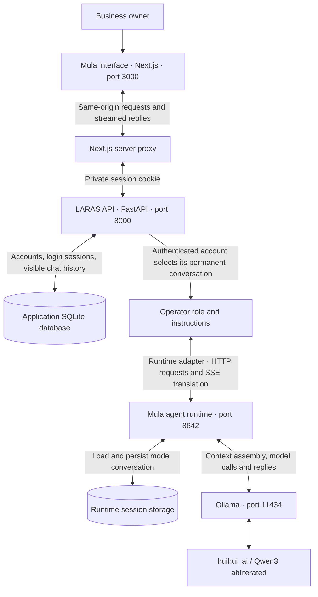
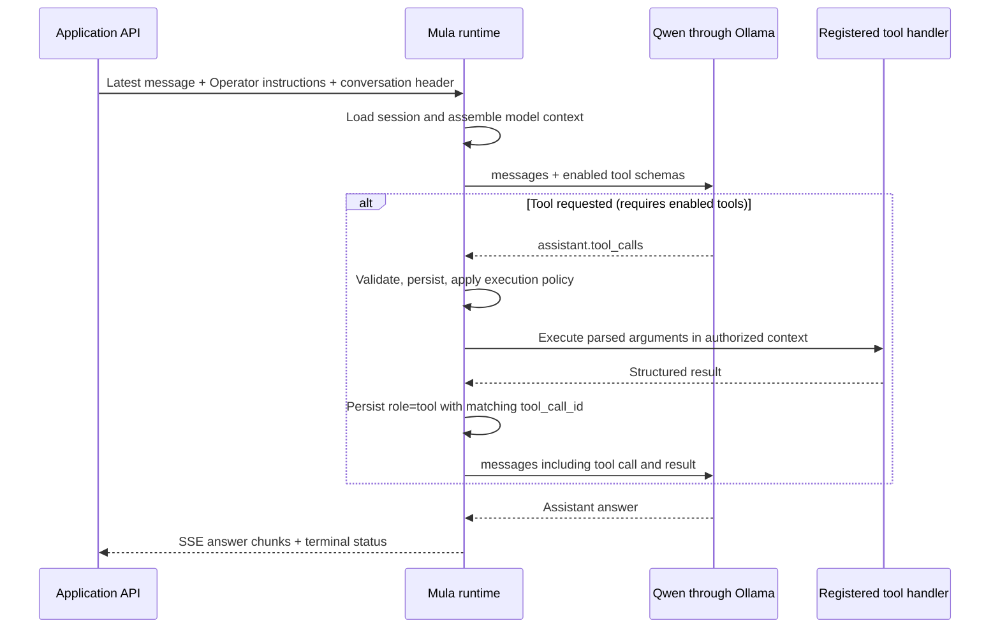

# Mula harness — current architecture

This document describes the implemented local application as of 2026-10-31. **Mula agent runtime** is the name used here for the upstream-based agent execution service. Mula is also the product name; LARAS remains the underlying system name.

The **harness** is the software around Qwen: account checks, agent instructions, conversation selection, model requests, context management, streaming, storage and process startup. Qwen generates the response; the harness determines which context reaches it and what actions are available.

## Architecture



The reply returns through the runtime adapter, FastAPI and Next.js proxy to the browser. FastAPI also saves the visible assistant response in the application database.

## Responsibilities

| Component | What it does today |
|---|---|
| Mula interface | Sign-up, sign-in, sign-out, one ongoing Operator chat, restored history, streamed text, Stop, TTS playback and a voice-reactive core. |
| Next.js server proxy | Forwards account cookies to the backend, checks mutation origins and relays responses. The runtime credential stays on the server. |
| LARAS API | Validates requests, authenticates accounts, checks conversation ownership and saves visible messages. |
| Operator role | Supplies business assistance instructions and limits. It is the only implemented agent role. |
| Runtime adapter | Sends the latest user message and Operator instructions to the runtime with the account's conversation ID; translates SSE into the app's newline-delimited events. |
| Mula agent runtime | Runs the agent machinery, loads model history, assembles context, invokes the model, persists runtime sessions and handles context compression. |
| Ollama | Serves the installed Qwen model locally. |
| Qwen | Generates answers from the instructions and supplied context. It does not authenticate accounts or own the application database. |

## What happens when someone sends a message

1. The browser submits the message with its login cookie.
2. The proxy forwards it to FastAPI.
3. FastAPI resolves the account from the login session. It selects the account's permanent conversation UUID. A supplied UUID belonging elsewhere is rejected.
4. FastAPI saves the user message and creates a placeholder for the assistant response.
5. The Operator entry point supplies its role instructions to the runtime adapter.
6. The adapter sends the new message to the Mula runtime with a namespaced conversation header and a server-held runtime credential.
7. The runtime loads the corresponding model history, builds the prompt, applies its context-management behavior and calls Qwen through Ollama.
8. Answer text streams back to the interface. The adapter filters reasoning and internal status events and checks completion status.
9. FastAPI saves the assistant response. Interrupted streams retain partial text with an interruption note when the stream finalizer runs.

Stop closes the stream toward the runtime, which cooperatively interrupts generation. It does not roll back work already performed.

## Voice output

After a successful text stream completes, voice mode strips Markdown/code from the reply and splits prose into bounded chunks. The browser calls `POST /api/speech` through the existing same-origin proxy and account-cookie boundary. FastAPI validates a maximum of 1,200 characters per request and uses the backend Mac's `say` executable to generate WAV audio. This is a presentation path, not an LLM tool call; it does not add messages to either conversation store or send a second model request.

`src/features/voice/services/speech.ts` decodes each returned WAV with Web Audio and connects a buffer source through an analyser to the output device. `OperatorCore.tsx` samples that analyser to animate the central core and rings. Reduced-motion mode keeps the drawing still. A generation counter invalidates pending fetch/decode work when playback is cancelled, preventing audio from starting after mute. New messages, tab hiding and sign-out stop current playback. Chat mode disables automatic speech and is persisted per browser in `localStorage`; loaded history never auto-plays.

The initial provider uses private temporary files, no shell, no external TTS API, uncached responses, one active synthesis job per process and a 30-second timeout. Temporary audio is deleted after reading. Closing a client connection does not guarantee immediate server-job cancellation, but the bounded job cannot resume playback in the cancelled client. The macOS provider must be replaced for a Linux production backend. Speech begins after reply completion, with possible pauses between chunks; microphone input is not included.

## Accounts and storage

One account currently represents one workspace and owns one Operator conversation. Signing out does not delete it. Refreshing or signing back in reloads the same visible chat.

| Storage | Contents | Current location |
|---|---|---|
| Application SQLite database | Accounts, salted password hashes, hashed login tokens, conversation UUIDs, visible user/assistant messages and login failure records. | `.runtime/accounts.sqlite3` by default; configurable with `LARAS_ACCOUNT_DB`. |
| Runtime session storage | Model conversation state and transcripts managed by the Mula runtime. | Dedicated profile under `.runtime/hermes`. |

These stores serve different purposes. The application database reloads what the user sees; the runtime store supplies the model's working conversation. The application does not replay its entire visible transcript into each runtime request.

Conversation ownership is enforced by FastAPI. The runtime is a shared local service authenticated using an application credential; it is not independently authenticated as each business owner. Separate runtime memory profiles per account are not implemented.

Login uses username/password credentials, salted scrypt password hashes and an opaque HttpOnly, SameSite=Strict cookie. Sessions expire after seven days. The first version does not have employee roles, invitations or password recovery.

## Context and memory today

| Mechanism | Current state |
|---|---|
| Recent conversation and runtime history | Active, selected by the account-owned conversation ID. |
| Context compression | Enabled with a configured trigger cap of 24,000 tokens; the six most recent messages are protected by the configuration. Compression is lossy and is not a hard per-request token limit. |
| Configured Qwen context window | 40,960 tokens. This is capacity, not a fixed charge or amount of work for every message. |
| Smaller-context compatibility | A reproducible local patch admits only the explicitly configured tool-free API Operator with the selected model and an 8,192–40,960-token window. Other cases retain the upstream minimum. |
| Structured long-term business memory | Not implemented. |
| Built-in persistent personal memory | Disabled in the shared runtime profile. |
| RAG over old conversations or documents | Not implemented. Saved transcripts are not automatically a retrieval index. |

Short replies, same-conversation recall and separation between new runtime conversations have been exercised previously. Full-window quality, compression under a long business workload and production throughput have not been established.

## Tools and specialist agents

The API and CLI toolsets are empty, and there are no configured MCP servers. The Operator performs planning and guidance; it cannot read live inventory, place purchases, publish a site or delegate to an Inventory/Procurement agent today.

The runtime supports an agent execution loop, but the current tool-free configuration follows the model-answer path. Tool schemas, tool dispatch, business permissions, approvals and specialist instructions must be introduced deliberately before multi-agent work can execute. Enabling tools also removes eligibility for the current smaller-context exception.

## Startup

```sh
bash /Users/rafa/Desktop/LARAS/run.sh
```

The launcher reuses reachable services, starts missing ones, waits for readiness and opens the interface. Ctrl+C stops only processes it started. Launcher logs live under `.runtime/logs`.

## Source map

- `src/features/workspace/components/Workspace.tsx`: account loading, permanent chat and streamed UI.
- `src/features/auth/components/AccountForm.tsx`: sign-up and sign-in.
- `src/common/services/server-proxy.ts`: server proxy and cookie forwarding.
- `src/features/voice/services/speech.ts` and `src/features/operator/components/OperatorCore.tsx`: cancellable playback and audio visualization.
- `server/src/features/voice/service.py`: bounded local macOS speech synthesis.
- `server/src/main.py`: application composition, validation-error handling and health checks.
- `server/src/features/auth/routes.py`: account HTTP endpoints.
- `server/src/features/operator/routes.py`: chat authorization, orchestration and visible transcript persistence.
- `server/src/features/auth/service.py`: SQLite accounts, login sessions and message records.
- `server/src/features/operator/agent.py` and `server/src/features/operator/prompts/operator.md`: Operator role.
- `server/src/features/operator/runtime.py`: runtime transport adapter.
- `server/hermes/config.yaml`: dedicated runtime profile template.
- `server/scripts/apply_hermes_profile.py`: pinned-runtime context exception.
- `run.sh` and `scripts/run.py`: one-command local startup.

## Naming and upstream attribution

The Mula agent runtime is based on [Nous Research's Hermes Agent](https://github.com/NousResearch/hermes-agent), pinned by `server/hermes/revision.txt`, with the local context exception described above. The upstream implementation and its license remain attributed. Existing source paths, environment variable names and wire-protocol identifiers still contain upstream terminology for compatibility. Calling the runtime Mula does not imply that those identifiers have been migrated.

# Technical execution specification

This section traces the checked-in application adapter and the pinned runtime source. Protocol identifiers below are literal compatibility identifiers; the service is called **Mula runtime** throughout the explanation.

## 1. Process and trust boundaries

```text
Browser / React state
  │ session cookie + JSON; same origin
  ▼
Next.js route handlers :3000
  │ server-to-server HTTP; cookie forwarded
  ▼
FastAPI :8000
  ├─ Account authorization → application SQLite
  ├─ Operator role instructions
  └─ Runtime HTTP adapter
       │ application bearer key + namespaced conversation ID
       ▼
Mula gateway :8642
  ├─ API admission / conversation ownership inside the runtime
  ├─ Session authority / active transcript / persistence
  ├─ AIAgent execution and context preparation
  ├─ Tool selection / argument parsing / dispatch (no tools enabled today)
  └─ Provider transport
       │ OpenAI-compatible model protocol
       ▼
Ollama :11434 → Qwen
```

The application cookie and runtime bearer key serve different principals. The cookie identifies one account. The runtime key authenticates the application to the shared runtime profile. Qwen sees prompt content, not a capability to access either SQLite database.

The application currently has no end-user tool identity propagated to a business-tool executor. A conversation ID is a routing identifier, not a business permission grant.

## 2. Account-to-conversation resolution

An account row holds `id`, `username`, `salt`, `password_hash`, and a unique `conversation_id`. Login creates a random session token. Only its SHA-256 digest and expiration are stored in the application's `sessions` table; the token is delivered in `mula_session`, an HttpOnly cookie.

For each chat request:

```sql
-- Simplified equivalent of current_account().
SELECT accounts.*
FROM accounts
JOIN sessions ON accounts.id = sessions.account_id
WHERE sessions.token_hash = :digest_of_cookie
  AND sessions.expires > :current_time;
```

FastAPI reads the conversation UUID from that account row. If a caller supplies `session_id`, it must equal the stored UUID, otherwise the request receives 403. An absent/expired login receives 401. The model never selects the account through generated arguments.

## 3. Visible-history restoration versus model-history restoration

### Visible history

On page load, the interface requests `/api/auth/me`, then `/api/conversation`. FastAPI loads:

```sql
SELECT id, role, text, note
FROM messages
WHERE account_id = :authenticated_account_id
ORDER BY id;
```

The response is shaped as:

```json
{
  "session_id": "<account-conversation-uuid>",
  "messages": [
    {"id": 1, "role": "user", "text": "Our shop is Mango Cafe", "note": null},
    {"id": 2, "role": "assistant", "text": "Understood.", "note": null}
  ]
}
```

React renders those records. This endpoint does not invoke Qwen, search a vector store, or reconstruct the runtime's internal tool transcript. It currently returns all application messages without pagination.

### Model history

When the user sends the next message, the browser sends just the new text, `stream: true`, and the account conversation ID. The application adapter makes this separate runtime request:

```http
POST /v1/chat/completions HTTP/1.1
Authorization: Bearer <server-held-runtime-key>
X-Hermes-Session-Id: mula-operator-<account-conversation-uuid>
Content-Type: application/json
```

```json
{
  "model": "hermes-agent",
  "messages": [
    {"role": "system", "content": "<contents of operator.md>"},
    {"role": "user", "content": "What is our shop called?"}
  ],
  "stream": true,
  "model_options": {"reasoning": {"enabled": false}}
}
```

The `model` field here names the gateway alias; the profile selects `huihui_ai/qwen3-abliterated:latest` downstream. The browser never receives the runtime bearer key.

The runtime's Chat Completions handler:

1. Separates system instructions from conversation messages.
2. Reads and validates the explicit session header. Explicit session continuation requires runtime API-key authentication.
3. Resolves the session's live compression continuation, when applicable.
4. Loads conversation messages with `SessionDB.get_messages_as_conversation(session_id)`.
5. Passes the Operator instructions as `ephemeral_system_prompt` and submits the current user message for execution.

The default runtime store is `<runtime-home>/state.db`, currently `.runtime/hermes/state.db`. Its model replay uses active message rows ordered by insertion ID. At a schematic SQL level:

```sql
SELECT <conversation_columns>
FROM messages
WHERE session_id IN (:resolved_session_ids)
  AND active = 1
ORDER BY id;
```

The real decoder restores message roles, tool-call structures and matching tool results, rather than flattening everything into one string. Compacted/inactive records are not automatically replayed into the model prompt.

The source also supports a canonical session-authority path. With that authority present, `_run_agent()` routes through `gateway/session_api_turn.py`. `history_from_session=True` submits `history: null` in the admission payload: execution restores the owning session transcript instead of freezing a caller-supplied history snapshot before queued turns complete. Logical owner resolution follows compression lineage. The preliminary HTTP-handler history load must not be mistaken for the only session restoration step.

The compatibility handler's preliminary history lookup has a warning-and-empty-history fallback on lookup failure. Successful HTTP delivery alone is therefore not proof that every prior message was restored. Runtime state and admission failures should be monitored separately from application liveness.

### The model's access boundary

Qwen cannot open `state.db` or fetch earlier messages by itself. Runtime code reads storage, builds a `messages` array, and supplies it through the model API. Information outside that request is not inherently accessible to the model.

Consequently, fewer bytes between FastAPI and the runtime do not mean fewer context tokens between the runtime and Qwen. Each model invocation processes its assembled input. Prefix/KV caching, when available, is a serving optimization; it is not the durable conversation store.

## 4. Prompt assembly and compression

The effective model input is conceptually:

```text
runtime base instructions and applicable runtime context
+ Operator instructions supplied by the application
+ active model conversation (possibly including a compression summary)
+ current user message
+ enabled tool schemas, if any
+ assistant tool calls and tool results from earlier iterations of this turn
```

The runtime assembles its own base prompt; `operator.md` is not necessarily the entire system prompt. `agent/system_prompt.py::build_system_prompt_parts()` groups base content into stable, context and volatile tiers. Role guidance, applicable workspace context, environment hints and enabled facilities can affect the final prompt. Disabled memory facilities do not contribute enabled personal-memory behavior.

Configured values:

```yaml
model:
  context_length: 40960
agent:
  max_turns: 8
  mula_compact_operator: true
compression:
  enabled: true
  threshold_tokens: 24000
  protect_last_n: 6
```

The absolute compression trigger caps the runtime's calculated ratio-based trigger. It is neither a fixed 24K prompt nor a hard 24K message truncation boundary. Recent-message protection is configuration for the compression algorithm; a long protected message can still consume substantial budget. Output reservation, summaries and runtime instructions also occupy context.

Compression is a sanctioned rewrite of active model context. The application can still display old messages from its own SQLite database after those details have been summarized out of the model's active transcript. RAG-based recovery from that archive is not implemented. Long-workload compression quality, summarizer routing and all small-context recovery paths have not been validated end to end; the local context patch specifically adjusts the agent startup guard, not every auxiliary-model feasibility check in the upstream runtime.

## 5. Tool selection, execution and the model loop

### Actual configuration

```yaml
platform_toolsets:
  api_server: []
  cli: []
mcp_servers: {}
```

The effective tool set is empty. There is no registered inventory function, procurement function, business MCP server or application-defined specialist. Describing an action in chat does not register executable functionality.

### Runtime machinery when tools are enabled

At agent initialization, `agent/agent_init.py` builds `agent.tools` from enabled/disabled toolsets and `model_tools.get_tool_definitions()`. It also derives `agent.valid_tool_names`. Provider transport includes the effective schemas in model requests when applicable.

A business-tool definition could look like the following. **This example is illustrative and is not installed in the current application.**

```json
{
  "type": "function",
  "function": {
    "name": "inventory_get_stock",
    "description": "Read current stock for one SKU in the authorized workspace.",
    "parameters": {
      "type": "object",
      "properties": {"sku": {"type": "string"}},
      "required": ["sku"],
      "additionalProperties": false
    }
  }
}
```

A model request would include the tool schema alongside `messages`. Qwen can then return an assistant message requesting a function call:

```json
{
  "role": "assistant",
  "content": null,
  "tool_calls": [{
    "id": "call_stock_1",
    "type": "function",
    "function": {
      "name": "inventory_get_stock",
      "arguments": "{\"sku\":\"COFFEE-1KG\"}"
    }
  }]
}
```

The `arguments` field is a JSON-encoded string, not executed source code. A schema describes the input shape; the handler must still validate business values and enforce authorization.

The runtime executes the following stages:

1. **Validate the requested function:** compare names against the session's available tools. Unknown calls must not reach a business handler; invalid calls can become structured error results for the model.
2. **Parse arguments:** `_parse_tool_arguments()` requires a valid JSON object. Invalid JSON/object shape returns an error instead of executing.
3. **Stage and persist the assistant call:** `turn_tool_round.py` appends the assistant's tool-call message and flushes the transcript before side effects. The path stops if required persistence fails.
4. **Run execution policy:** apply runtime hooks/middleware, available authorization/guardrail checks and tool-specific approval requirements. Existing runtime middleware is not a substitute for Mula business authorization.
5. **Dispatch:** `tool_executor.py` handles inline agent tools, delegation, context-engine tools and memory-provider tools specially; ordinary registered tools go through `model_tools.handle_function_call()` to the registry. Configured MCP tools ultimately invoke their MCP server instead of an application-local handler.
6. **Commit the result:** append a `role: tool` message containing the matching `tool_call_id`. Result processing can include limits, spillover to disk and persistence.
7. **Invoke the model again:** include the assistant tool request and its tool response in the next model input. Qwen can request another tool or produce the final answer.

Example tool response:

```json
{
  "role": "tool",
  "tool_call_id": "call_stock_1",
  "name": "inventory_get_stock",
  "content": "{\"sku\":\"COFFEE-1KG\",\"available\":12,\"unit\":\"bag\"}"
}
```

The schematic loop is:

```text
prepare context and allowed tool definitions
repeat within runtime iteration budget:
    call model
    if model requests tools:
        validate and persist assistant tool-call message
        authorize and execute allowed handlers
        append and persist matching tool-result messages
        continue with updated context
    else:
        finalize assistant answer
        stop
```

The runtime supports sequential, concurrent and segmented tool batches. Parallel execution depends on its execution policy and the tool batch; multiple tool calls are not universally safe to run together. `agent.max_turns: 8` sets the configured iteration budget, not eight lifetime user messages. Runtime wrap-up/recovery behavior means it should not be presented as an exact maximum of eight HTTP/model calls under every failure condition.

## 6. Tool protocol versus frontend streaming protocol



The model-facing `tool_calls` exchange is internal to the runtime execution. It is distinct from the app-facing stream of answer events. The browser is not asked to execute those function calls, and our FastAPI adapter is not the runtime's general tool dispatcher.

The runtime emits SSE such as `data: {"choices":[{"delta":{"content":"Hello"},"finish_reason":null}]}`. The adapter converts answer text into:

```json
{"type":"session","session_id":"<account-conversation-uuid>"}
{"type":"token","content":"Hello"}
{"type":"done","truncated":false}
```

It accepts successful `stop` or partial `length` terminal reasons, followed by `[DONE]`. Missing termination, malformed data, errors or cancellation are not reported as successful completion. Reasoning fields are not forwarded. Named tool-progress/status events are currently ignored by this UI adapter. Approval requests produce an explicit error and close the stream, because the app has no approval-response interface yet.

Even JSON-mode application requests internally consume this runtime streaming path and aggregate its text, keeping the same completion checks.

## 7. Business authorization needed before enabling tools

A correct future business tool call must bind:

```text
account / workspace identity established by application authentication
+ role permissions
+ allowed tool / operation
+ validated arguments
+ applicable approval decision
+ idempotency identity for consequential writes
```

Our current adapter passes a runtime application credential and conversation routing ID. It does not pass a validated tenant capability to an inventory/procurement service. A future handler must obtain authoritative workspace identity from trusted server execution context, not from a `workspace_id` invented by the model.

Runtime transcript persistence also does not make external business writes exactly-once. Purchasing APIs and stock updates require their own transaction/idempotency design. Current API chat requests do not supply an application idempotency key.

Delegation is a tool execution path with additional child-agent lifecycle machinery. Enabling a delegation tool alone does not create an Inventory specialist, configure its permission set or give it access to inventory records.

## 8. Persistence, cancellation and current consistency limits

Application and runtime persistence happen in separate stores with no distributed transaction:

```text
application saves user + assistant placeholder
    → runtime admission and execution
    → runtime persists its model transcript
    → application saves final or interrupted visible answer
```

Failures can leave one store ahead of the other. Application history is not currently an automatic disaster-recovery source for missing runtime state. Replaying displayed chat after losing `state.db` would require an explicit recovery path.

The runtime has session admission/turn ownership machinery, but FastAPI currently performs its own user/placeholder inserts before runtime execution without an application-level turn lock. Concurrent tabs can therefore produce display ordering that needs further reconciliation. Application history also has no pagination yet.

Frontend Stop cancels the browser request, which closes the proxy/backend stream. The adapter's async context managers close its upstream connection, allowing the runtime to detect disconnect and cooperatively interrupt the agent. Already-issued model work may take time to stop. If write tools are added, cancellation will not reverse completed side effects.

## 9. Exact implementation references

Application references:

- `server/src/features/auth/service.py`: `current_account()`, `history()`, `add_message()`, `save_reply()`.
- `server/src/features/operator/routes.py`: `chat_with_operator()`, `operator_events()`, `conversation()`.
- `server/src/features/operator/agent.py`: `operator_reply()`, `operator_stream()` and loading `operator.md`.
- `server/src/features/operator/runtime.py`: `request_headers()`, `stream_chat()`, `sse_events()`, `chat()`.
- `src/common/services/server-proxy.ts`: `proxyBackend()`.
- `src/features/workspace/components/Workspace.tsx`: `loadAccount()`, `sendMessage()` and `readChatStream()` usage.

Pinned runtime references, relative to `.runtime/hermes-source`:

- `gateway/platforms/api_server_openai_routes.py`: session header parsing, model-history restore and `_authority_chat_kwargs()`.
- `gateway/platforms/api_server.py`: `_run_agent()` and runtime agent construction.
- `gateway/session_api_turn.py`: canonical admission and session-owned history selection.
- `hermes_state_messages.py`: `get_messages_as_conversation()`, active-row selection and role restoration.
- `agent/system_prompt.py`: `build_system_prompt_parts()`.
- `agent/conversation_loop.py`: conversation execution and iteration orchestration.
- `agent/agent_init.py`: effective tool surface and `valid_tool_names`.
- `agent/turn_tool_round.py`: validation, assistant tool-call staging and pre-execution persistence.
- `agent/tool_executor.py`: JSON argument parsing, specialized/registry dispatch and result commit.
- `model_tools.py`: `get_tool_definitions()` and `handle_function_call()`.

These references document current code behavior and supported runtime machinery. The inventory examples above are explanatory protocol examples, not claims of deployed business functionality.
